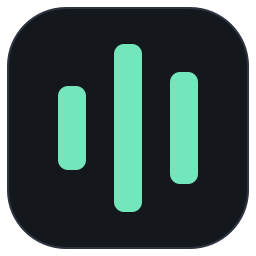

<p align="center">
  
</p>

<h1 align="center">Stream Studio</h1>

<p align="center">
  <strong>Your Twitch and Kick streams, together.</strong><br>
  Live streams, chat, replays, and offline viewing in one Windows desktop app.
</p>

<p align="center">
  <strong><a href="https://github.com/CorontoSiete/streamlink-vlc-studio/releases/latest">Download for Windows</a></strong>
  &nbsp;·&nbsp;
  <a href="https://github.com/CorontoSiete/streamlink-vlc-studio/releases">Release notes</a>
  &nbsp;·&nbsp;
  <a href="https://github.com/CorontoSiete/streamlink-vlc-studio/issues">Report an issue</a>
</p>

<p align="center">Windows 10 &amp; 11 · 64-bit</p>

---

Follow your favorite channels, watch up to **16 streams at once**, and pick up past broadcasts where you left off. Stream Studio combines Streamlink with embedded VLC playback and offers an optional browser player for other devices on your home network.

**Start here:** [Install](#install-latest-release) · [Getting started](#getting-started) · [Shortcuts](#keyboard-shortcuts) · [Other devices](#watch-on-other-devices) · [Troubleshooting](#troubleshooting) · [Build from source](#build-and-run) · [Documentation](#documentation)

## Features

| Feature | What it offers |
| --- | --- |
| **One library, two platforms** | Search Twitch and Kick channels, browse categories, filter by language, and see which followed channels are live. |
| **Flexible viewing** | Switch between tabs, build a grid of up to 16 streams, or use picture-in-picture and fullscreen. |
| **Chat your way** | Choose overlay or docked chat with emotes and badges. Read live chat without signing in; connect an account to send messages. |
| **Replay and resume** | Rewind supported live broadcasts and resume past broadcasts, also called VODs, with replay chat. |
| **Offline library** | Save completed Twitch and Kick VODs as HLS or MP4, then watch, seek, and resume without an internet connection. |
| **Channel tools** | Create clips from live streams, follow channels, receive live notifications, and optionally claim available Twitch channel-point bonuses. |
| **Home-network player** | Watch from a compatible TV, phone, tablet, or Linux browser, with separate web accounts and saved preferences. |

Live replay depends on the platform making replay footage available; Kick replay support is best-effort. Offline downloads contain video and audio, but do not include replay chat.

## Install latest release

### What you need

- **64-bit Windows 10 or Windows 11.**
- **Administrator permission** for the standard installer.
- **Internet access** for streaming, account connections, and downloading VODs.

The setup file includes the app and the required Streamlink, VLC, and Microsoft Edge WebView2 installers. The app also includes its .NET runtime. **You do not need a .NET SDK to use a release.**

### Download and install

1. Open the **[latest release](https://github.com/CorontoSiete/streamlink-vlc-studio/releases/latest)** and expand **Assets** if needed.
2. Download **`StreamlinkVlcStudio-Setup.exe`** and **`SHA256SUMS.txt`**. Choose the setup file; the source-code archives are for development.
3. Verify the download using the instructions below, then run Setup and follow the prompts. Restart Windows if requested.
4. Launch **Stream Studio** from the installer or Start Menu. In the first-run setup, connect Twitch, Kick, both, or skip account setup to watch public streams.

Sign-in and consent happen on the platform's own page. You do not need to register a developer application or supply a client secret for normal setup.

<details>
<summary><strong>Verify your download</strong></summary>

Open PowerShell in the folder containing the downloaded files and run:

```powershell
Get-FileHash .\StreamlinkVlcStudio-Setup.exe -Algorithm SHA256
```

Compare the resulting hash with the `StreamlinkVlcStudio-Setup.exe` entry in `SHA256SUMS.txt` from the same release. The values must match. If they differ, download the files again before running Setup.

</details>

<details>
<summary><strong>Alternative: install from a release ZIP</strong></summary>

Download `StreamlinkVlcStudio-release.zip` and `SHA256SUMS.txt` from the same release. Verify the ZIP with `Get-FileHash`, then extract it and open **64-bit PowerShell** in the extracted folder.

```powershell
powershell.exe -ExecutionPolicy Bypass -File .\install.ps1 -AppSource Local -Launch
```

This installs to `%LOCALAPPDATA%\Programs\StreamStudio` by default and installs any required dependencies. See the [installation reference](docs/REFERENCE.md#install-latest-release) for custom folders, dependency-only repair, and other options.

</details>

## Getting started

### 1. Find something to watch

Enter a Twitch or Kick channel name or URL in the **Home** search bar, then select a result. You can also open a channel from **Followed**, **Browse**, or **Recent**.

For a previous broadcast, open **Past broadcasts** or paste a supported VOD URL into the search bar.

### 2. Arrange your streams

- **Tabs:** switch between open streams.
- **Multi-stream grid:** select **M** in the toolbar to watch several streams together.
- **Picture-in-picture:** keep a player visible while using other windows.
- **Audio:** the selected main stream plays audio by default. Enable **Never mute** on a tab to keep its audio playing when you switch tabs or return Home.

### 3. Connect accounts for more features

Public streams and read-only live chat work without an account. Open **Settings > Accounts** whenever you want to connect or manage an account.

| What you want to do | How to set it up |
| --- | --- |
| Load Twitch follows, browse Twitch VODs, send Twitch chat, or create Twitch clips | Select **Connect Twitch** and approve access in your browser. |
| Send Kick chat and enable account-backed live-status checks | Select **Connect Kick** and approve access in your browser. |
| Import the channels you follow on Kick | Open **Settings > General > Followed channels > Detect Kick follows**, sign in, and select **Import follows**. Repeat the import when your follows change. |
| Claim available Twitch channel-point bonuses | In the Twitch account settings, select **Sign in for bonuses** and enable **Automatically claim Twitch bonuses**. |

Kick follow import and Twitch bonuses require separate website sign-ins from the **Connect** buttons. Twitch bonus checks do not guarantee watch-time points; see the [channel-point reference](docs/REFERENCE.md#twitch-channel-point-bonuses) for details.

### Save broadcasts for later

Past broadcasts include replay chat and automatically resume from your saved position. To save a local copy, select **Download** on a completed VOD or paste its URL into **Downloads**.

Choose the destination, quality, format, and bandwidth limit in **Settings > Downloads**. By default, files are saved to `StreamStudio VODs` in your Windows Videos folder. MP4 downloads and format conversion require FFmpeg; HLS downloads do not. See the [download guide](docs/vod-downloads.md) for setup and storage details.

## Keyboard shortcuts

These are the desktop defaults. Customize them in **Settings > Hotkeys**.

| Shortcut | Action |
| --- | --- |
| **Space** | Pause or resume the selected player. |
| **M** | Toggle the multi-stream grid. |
| **Up / Down** | Raise or lower the selected stream's volume by 5%. |
| **Left / Right** | Switch tabs. |
| **Numpad 4 / Numpad 6** | Skip backward or forward by 30 seconds in seekable playback. |
| **Mouse4** (first side button) | Return to the previous page or stream. |

Right-click a skip binding in Hotkeys to change its skip amount from 1 to 300 seconds. Shortcuts and skip amounts save automatically.

## Watch on other devices

The optional browser player lets compatible devices on your local network (LAN) use Stream Studio through your Windows PC.

1. Open **Settings > Advanced > Playback tools > LAN browser server**.
2. Create a web account with a username and a password of at least 12 characters. This is separate from your Twitch or Kick account.
3. Select your private Ethernet or Wi-Fi address, then select **Start server**.
4. Open the displayed **HTTPS** address on a device on the same LAN and sign in with that web account.

Keep Stream Studio running on the Windows PC while you watch. Follow the [LAN browser setup guide](docs/local-web-server.md) for certificate setup, browser and video-codec compatibility, and connection troubleshooting.

> **Local-network use only:** keep this service on your home network and do not forward its port to the internet.

## Updates and removal

### Update the app

Stream Studio checks for stable releases automatically. To update manually, open **Settings > Advanced > Updates**, download the verified update, and select **Restart and install**. Automatic downloads are optional; installation starts when you choose **Restart and install**. Release notes are available in **Settings > Changelog**.

> **Upgrading an older installation:** Versions **1.7.1 and earlier** need one manual upgrade using the latest `StreamlinkVlcStudio-Setup.exe`. ZIP/PowerShell installations older than **1.8.7** also need one manual upgrade before using in-app updates.

### Repair or uninstall

To repair an installation, rerun the setup file for your installed version. To remove it, uninstall **Stream Studio** from Windows **Apps & features** or **Programs and Features**. Clear the installer's data-removal checkbox to keep your settings and cache. Shared Streamlink, VLC, and WebView2 installations are retained.

For a ZIP/PowerShell installation, use `Uninstall.exe` in the installed app folder. Add `--preserve-user-data` to keep settings and cache. More recovery and maintenance options are in the [installation reference](docs/REFERENCE.md#install-latest-release).

## Troubleshooting

<details>
<summary><strong>A stream will not play, or a dependency is missing</strong></summary>

Rerun Setup to repair the installation. In Settings, check that the Streamlink path points to `streamlink.exe` and the VLC directory contains `libvlc.dll`.

</details>

<details>
<summary><strong>I can read chat but cannot send messages</strong></summary>

Connect or reconnect the appropriate account in **Settings > Accounts**. Chat sending is disabled while watching behind live or playing a VOD; return to the live stream to send messages.

</details>

<details>
<summary><strong>My followed channels or past broadcasts are missing</strong></summary>

- **Twitch:** select **Connect Twitch** again to refresh the account's permissions.
- **Kick:** run **Detect Kick follows** again and select **Import follows**. Connecting Kick alone does not import followed channels.

</details>

<details>
<summary><strong>I cannot rewind a live stream</strong></summary>

The platform may not make replay footage available for that broadcast. Check the seekbar's status or tooltip for details. Kick replay lookup is best-effort.

</details>

<details>
<summary><strong>Another device cannot connect to the browser player</strong></summary>

Check the selected LAN address, Windows Firewall's Private-network access, VPN local-network sharing, and the certificate instructions in the [LAN browser setup guide](docs/local-web-server.md).

</details>

**Settings and logs:** settings are stored in `%APPDATA%\StreamStudio\settings.json`; logs are stored in `%LOCALAPPDATA%\StreamStudio\studio.log`. Account tokens are encrypted for the current Windows user. Treat settings, backups, and browser profiles as private, and remove account information before sharing diagnostic files.

## Build and run

For development, use 64-bit Windows 10 or Windows 11, PowerShell 5.1 or 7, and the **x64 .NET SDK version pinned in [global.json](global.json)**. The first dependency restore needs internet access. Running the app also requires Streamlink, 64-bit VLC, and WebView2.

Clone or extract the source, then open PowerShell in the folder containing `StreamlinkVlcStudio.sln`:

```powershell
# Build the solution.
.\scripts\dev.ps1 Build

# Build and launch the app in Debug mode.
.\scripts\dev.ps1 Run -Configuration Debug
```

The development script finds the pinned SDK, restores locked dependencies, and manages the build environment. For a custom SDK location, add `-DotNetPath 'C:\SDKs\dotnet\dotnet.exe'`.

Keep the bundled native overlay files under `src\StreamlinkVlcStudio.Infrastructure\Vlc\BundledOverlay\build`; they are required build inputs. See the [source setup guide](START-HERE.md) and [development reference](docs/REFERENCE.md#build-and-run) for details.

## Test

Run these commands from the repository root:

```powershell
# Restore, build, and run the headless-safe test suite.
.\scripts\dev.ps1 Test

# Run tests for a specific subsystem.
.\scripts\dev.ps1 Test -Filter 'stream open workflow:'

# Check formatting, scripts, native inputs, the build, and the full test suite.
.\scripts\dev.ps1 Check
```

Add `-Interactive` to include tests that open windows and drive desktop input. Use `-NoBuild` with `Test` only when rerunning an existing build. See [test configuration and fixtures](docs/REFERENCE.md#test) for skip limits, environment settings, and live-provider checks.

## Documentation

Choose a guide for your next step:

| Guide | What it covers |
| --- | --- |
| [Detailed reference](docs/REFERENCE.md) | Full feature behavior, account options, replay controls, test fixtures, and manual verification. |
| [VOD downloads](docs/vod-downloads.md) | Offline storage, HLS/MP4 formats, FFmpeg, conversion, and download recovery. |
| [LAN browser player](docs/local-web-server.md) | Web accounts, certificates, browser compatibility, and network boundaries. |
| [Kick follow import](docs/kick-follow-import.md) | Importing follows, website sign-in, and platform limitations. |
| [Channel following](docs/channel-follow.md) | Following broadcasters from the player and account behavior. |
| [Architecture](docs/ARCHITECTURE.md) | Application structure, playback, chat, and service boundaries. |
| [Packaging and releases](docs/REFERENCE.md#package) | Installer builds, required assets, dependency verification, and signing. |
| [Account service deployment](docs/account-connections.md) | Publisher and developer configuration for account connections. |
| [Third-party notices](THIRD-PARTY-NOTICES.md) | Notices for included dependencies and assets. |

## Feedback and bug reports

[Open an issue](https://github.com/CorontoSiete/streamlink-vlc-studio/issues) and include:

- Your Stream Studio version and Windows version.
- The affected platform: Twitch, Kick, or the LAN browser player.
- Steps to reproduce the problem, what you expected, and what happened.
- The error message and relevant log excerpts, with private information removed.

For a feature request, describe what you want to do and how it would improve your viewing experience.
